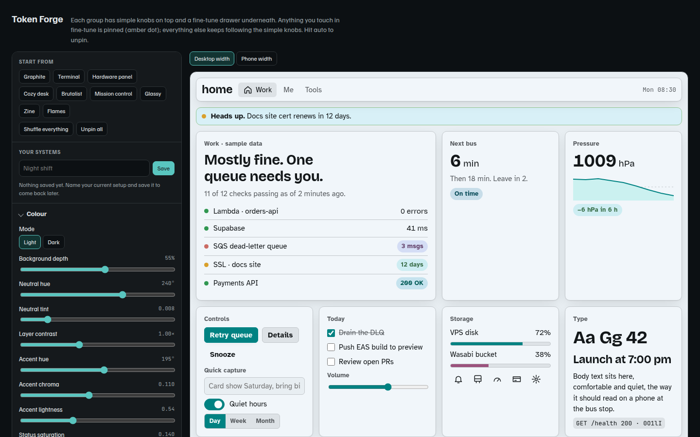

# Token Forge

A design-token playground. Turn a handful of knobs (colour, type, shape,
depth, motion, component styles), watch a realistic dashboard restyle live,
then export the result as CSS, Tailwind v4, design-token JSON, or a Markdown
brief you can hand to an AI coding assistant.

**Live demo: <https://suchlandtsirenity.github.io/token-forge/>**



- **Works like clay.** Start with a few broad controls per group, then open
  nested folds to work inward as far as you want. Anything you touch in a fold is
  *pinned* and stops following the broad knobs, while everything else keeps
  following. Closed folds show how many pins are inside, and any fold can be
  unpinned to smooth it back.
- **Colour in OKLCH.** Palettes are built in a perceptual colour space, so a
  lightness or hue change behaves the way it looks. Any colour can be pinned to
  an exact hex.
- **Readability checks.** Live WCAG contrast for text, muted text, button
  labels, accent text and borders. Every built-in preset passes them, and a
  test keeps it that way.
- **Nine presets** (Terminal, Hardware panel, Zine, …), a shuffle, and named
  saves in your browser.
- **Round-trip export.** The JSON export carries the full settings, so pasting
  it back in restores the exact system.

## How it's built

No dependencies and no build step: plain browser JavaScript modules.

| | |
|---|---|
| `src/color.js` | OKLCH ↔ sRGB conversion, gamut clamping, WCAG contrast. Pure functions |
| `src/tokens.js` | Defaults, presets, and `derive(state)`, which turns knobs plus pins into every token value |
| `src/controls.js` | The control tree: simple knobs, then folds nested to any depth, with pin counting for any subtree |
| `src/export.js` | CSS / Tailwind v4 / JSON / Markdown output |
| `src/fonts.js` | The Google Fonts catalogue and fallback stacks |
| `src/app.js` | Everything that touches the DOM or `localStorage` |
| `test/` | 39 tests with `node:test`, covering colour maths, derivation, every preset's contrast, the exports, and the control tree |

Everything except `app.js` is free of DOM code, which is what lets the
colour and token logic be tested directly in Node.

### How this was built

Token Forge started as a single-file prototype built with Claude in a chat,
then moved into this repo with Claude Code: split into modules, given tests,
and checked against its own readability rules. That last step found real bugs:
five presets shipped with button labels below 4.5:1 and four with borders below
their own threshold. The [build log](docs/build-log.md) covers what changed and why.

## Running it

```sh
npm start     # serves on http://localhost:8000 (needs python3)
npm test      # Node 22+
```

Any static file server works. The page has to be served rather than opened
from disk, because browsers block ES modules on `file://`.

## License

[MIT](LICENSE)
