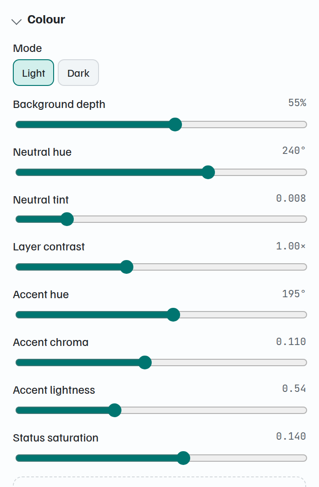
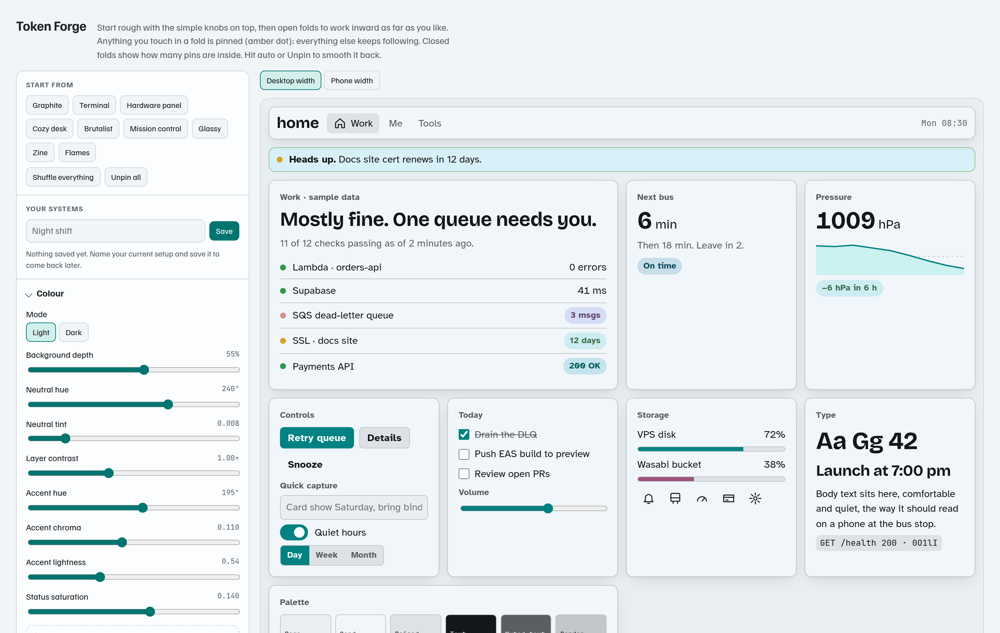

# Token Forge changelog

A dependency-free design-token playground: a handful of knobs (colour, type,
shape, depth, motion, component styles) restyle a realistic dashboard live, and
the result exports as CSS, Tailwind v4, design-token JSON, or a Markdown brief
for an AI coding assistant. Plain notes on what shipped, why it matters, and
what it still can't do. Newest first. The longer story is in
[`docs/build-log.md`](../build-log.md).

---

## 2026-11-05 — Recursive folds: the rail opens as deep as you want

**Shipped.** The control rail had two levels — simple knobs and one Fine-tune
drawer. It is now a tree with one repeating unit, the **fold**, nesting to any
depth: broad knobs at the top, then Colour → Fine-tune → Hues → Every colour,
individually. Anything you touch inside a fold is *pinned* and stops following
the broad knob above it; everything else keeps following. A closed fold shows how
many pins are inside it, and any fold can be unpinned to smooth it back.

**Why it matters.** The design principle is clay: rough shapes first, detail only
where you want it. Depth is now available without being imposed, and the control
schema moved out of `app.js` into `src/controls.js` so the whole tree can be
tested under Node instead of only in a browser.

**Limits, honestly.** It is still one rail: there is no search across controls,
and a deep pin is only discoverable by opening the folds above it. Pin keys did
not change, so saved systems and old exports load as they did, with their pins
appearing in the new folds.

**Checked.** 39 tests pass (`npm test`, `node --test`, run under Node 26 here; CI
runs Node 22 and 24) including the whole control tree, and in a real browser:
pinning three levels down raises the count on every fold above it, unpinning an
inner fold leaves its siblings alone, and pins survive a reload. One check was
wrong rather than the code: `offsetParent` reports rows in closed `
` as
visible, so a check built on it gave a false alarm; `checkVisibility()` gave the
real answer — no fine rows showing at the start.

## 2026-11-03 — Imported into a repo, tested, and published

**Shipped.** The single-file prototype (about 670 lines of markup, CSS and script,
built in a Claude chat) was split by responsibility with no behaviour change:
`src/color.js` (OKLCH ↔ sRGB, gamut clamping, WCAG contrast), `src/tokens.js`
(defaults, presets, `derive()` — the one place token values are computed),
`src/export.js`, `src/fonts.js`, and `src/app.js` for everything that touches the
DOM or `localStorage`. Then `CLAUDE.md` with the rules the code relies on, a
README, the build log, a licence, a screenshot, and CI running the tests on Node
22 and 24. GitHub Pages serves `main` from the repo root: nothing to build, what
is committed is what is live.

**Why it matters.** Once `derive()` was a pure function of state, the colour and
token logic could be tested with no browser — which is how six of the nine presets
were caught failing their own on-screen readability checks.

**The bugs the tests found.** Button labels on accent buttons were chosen by
OKLCH lightness as a stand-in for contrast; WCAG contrast follows relative
luminance, so a saturated cyan or orange at the same lightness got a white label
that didn't read (Hardware panel 3.53 → 5.22, Glassy 3.18 → 5.63). Both candidate
labels are now built and the higher-contrast one kept, with two presets' accent
lightness nudged by 0.01–0.02 where neither label reached 4.5. Borders offset from
the page lightness by a fixed step did not reach the 1.5:1 border check in dark
mode (Terminal 1.19, Mission control 1.25, Flames 1.21); the steps are now the
smallest values that pass for every preset.

**Also.** The preview's sample data was made generic (no real project names), and
custom font names are escaped before they are built into font menus.

**Limits, honestly.** The presets keep their contrast by construction, not by
design review: the thresholds are never loosened to make one pass, so a future
preset that can't pass has to change instead.

**Checked.** 39 tests pass under Node (`npm test`).
