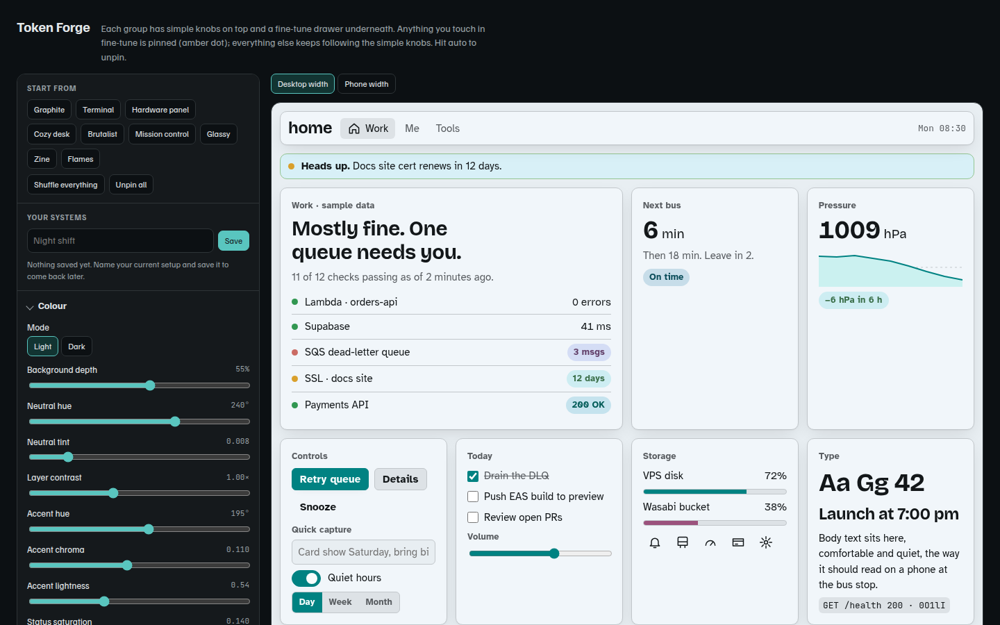

## one batch — imported, tested, published

**Into a repo.** The single-file prototype (about 670 lines of markup, CSS and
script, built in a Claude chat and not kept as a transcript) was split by
responsibility with no behaviour change: `src/color.js` for the colour maths,
`src/tokens.js` for defaults, presets and `derive()`, `src/export.js`,
`src/fonts.js`, and `src/app.js` for everything that touches the DOM or
`localStorage`. `derive()` takes the state as an argument rather than reading a
global, which is what made the colour and token logic testable under Node with no
browser.

**Tests, and the bugs they found.** The test plan mirrors what the app already
promises: the readability panel shows five contrast checks with pass/fail
thresholds, so the tests apply the same checks to every built-in preset. Six of the
nine presets failed their own checks. Button labels were chosen by OKLCH lightness
as a stand-in for contrast, but WCAG contrast follows relative luminance, so a
saturated cyan or orange at the same lightness got a white label that didn't read
(Hardware panel 3.53 → 5.22, Glassy 3.18 → 5.63, Cozy desk 4.06 → 4.54, Graphite
4.37 → 4.55, Zine 4.19 → 4.55). Both candidate labels are now built and the
higher-contrast one kept, with Graphite's and Zine's accent lightness nudged down
by 0.01 and 0.02 where neither label reached 4.5. Borders offset from the page
lightness by a fixed step missed the panel's 1.5:1 border check in dark mode
(Terminal 1.19, Mission control 1.25, Flames 1.21) and in Cozy desk's light mode
(1.49); the steps are now 0.22 dark and 0.12 light, the smallest values that pass.
One test was wrong rather than the code: the first draft guessed the OKLCH value
of `#e53935`; it now checks the pinned hex comes back unchanged, which is the
actual promise.

**Publishing.** `CLAUDE.md` records the rules later sessions must keep: `derive()`
is the only place colours are computed, the core modules stay DOM-free, and presets
must pass the readability tests rather than having the thresholds loosened. CI runs
the tests on Node 22 and 24, and GitHub Pages serves `main` directly — there is
nothing to build.

**Also.** The preview's sample data was made generic, and custom font names are
escaped before they are built into font menus.

**Limits, honestly.** The prototype's conversation is not archived — it was a
claude.ai chat, so there is no transcript to publish. The hand-check of the module
version against the prototype (every preset, shuffle, pinning and unpinning, all
four exports, the hex/OKLCH toggle, JSON import) was done by eye, not automated.
