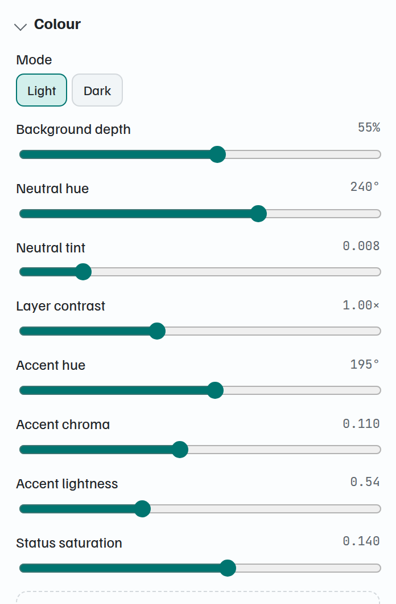
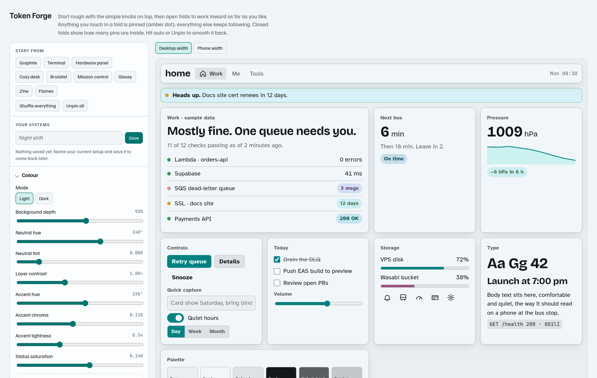
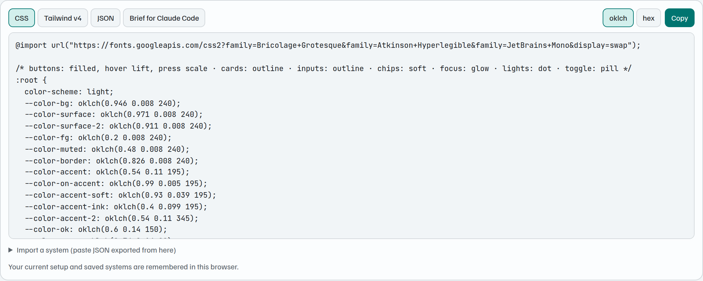

## one batch — recursive folds

**Shipped.** The rail had two levels: simple knobs and one Fine-tune drawer. The
design is meant to work like clay — rough shapes first, detail only where you want
it — so depth needs to be available without being imposed. The control schema moved
out of `app.js` into `src/controls.js`, because a schema inside the DOM code could
not be tested. It is now a tree with one repeating unit, the **fold**, so pin counts
and Unpin work the same at every level.

**Why it matters.** Any value has a derived default, lives in a fold, pins when
touched and can return to following its parent. Pin keys did not change, so saved
systems and old exports load as they did, with their pins showing up in the new
folds.

**Checked.** In a real browser: pinning three levels down raises the count on every
fold above it, unpinning an inner fold leaves its siblings alone, and pins survive a
reload. `offsetParent` reports rows in closed `
` as visible, so a check
built on it gave a false alarm; `checkVisibility()` gave the real answer — no fine
rows showing at the start. 39 tests pass (`npm test`, `node --test`; run under Node
26 for this record, CI runs Node 22 and 24).

**Limits, honestly.** It is still one rail: there is no search across controls, and
a deep pin is only discoverable by opening the folds above it. The pin count says
how many pins are inside a fold, not which ones.
